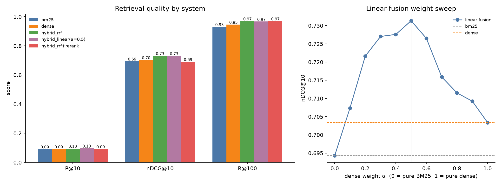

# Hybrid Search Lab — Benchmark Deep-Dive

> Supplementary experimental notes for the main [project README](README.md).
> This file intentionally focuses on details that are not covered in the main README:
> extended metric breakdowns, runtime-stage costs, query-level reranking examples,
> and interpretation of the fusion sweep.

## 1. Extended metric breakdown

The main README reports the headline metrics. The table below adds the remaining
cut-off metrics from the same 300-query SciFact run.

| System | P@1 | P@5 | nDCG@5 | R@10 |
|---|---:|---:|---:|---:|
| BM25 | 0.5700 | 0.1607 | 0.6651 | 0.8310 |
| Dense | 0.6033 | 0.1693 | 0.6826 | 0.8162 |
| Hybrid RRF | 0.6033 | **0.1773** | **0.7157** | 0.8543 |
| Hybrid Linear (α=0.5) | 0.6033 | 0.1733 | 0.7043 | **0.8646** |
| Hybrid + Rerank | 0.5700 | 0.1647 | 0.6639 | 0.8272 |

**Reading this table:** RRF has the strongest nDCG@5 and P@5 in this run.
Linear fusion has the strongest R@10. Dense retrieval has the highest P@1,
tied with the two non-reranked hybrid systems.

## 2. Runtime-stage breakdown

The reported latency is the cumulative per-query cost measured in the benchmark
environment. The stage timings below help explain where that cost comes from.

| System / stage | Approx. time per query |
|---|---:|
| BM25 retrieval | 0.64 ms |
| Dense retrieval | 12.89 ms |
| RRF fusion | 0.21 ms |
| Linear fusion | 0.25 ms |
| RRF + cross-encoder reranking stage | 4,169.93 ms |

The reranking stage dominates the measured runtime in this run. Its total
pipeline latency is approximately 4,183.7 ms/query, compared with approximately
13.7 ms/query for RRF without reranking. These measurements are specific to
the machine, software environment, batching, and model execution configuration;
they should not be treated as universal speed guarantees.

## 3. Linear-fusion sweep: all tested values

The plot below is included here as a detailed experimental artifact. The
dense-weight parameter α ranges from 0 (BM25-only endpoint) to 1 (dense-only
endpoint).

| Dense weight α | nDCG@10 |
|---:|---:|
| 0.0 | 0.6943 |
| 0.1 | 0.7074 |
| 0.2 | 0.7216 |
| 0.3 | 0.7270 |
| 0.4 | 0.7276 |
| 0.5 | 0.7313 |
| 0.6 | 0.7265 |
| 0.7 | 0.7159 |
| 0.8 | 0.7115 |
| 0.9 | 0.7093 |
| 1.0 | 0.7034 |

The curve rises as dense retrieval is introduced, reaches its highest observed
value at α=0.5, and then declines as the dense component receives more weight.
Because these weights were evaluated on the same evaluation queries, this is
a sensitivity analysis rather than a held-out hyperparameter-selection result.

## 4. Query-level reranking examples

Aggregate metrics show that the tested reranker reduced nDCG@10 overall, but
the per-query examples show that its effect was not uniform.

### Examples where reranking improved nDCG@10

| Query / claim text | Before (RRF) | After (rerank) |
|---|---:|---:|
| Silencing of Bcl2 is important for the maintenance and progression of tumors. | 0.32 | 1.00 |
| Vitamin D deficiency effects the term of delivery. | 0.39 | 1.00 |
| Crosstalk between dendritic cells (DCs) and innate lymphoid cells (ILCs) is important in the regulation of intestinal homeostasis. | 0.43 | 1.00 |

### Examples where reranking reduced nDCG@10

| Query / claim text | Before (RRF) | After (rerank) |
|---|---:|---:|
| Activation of PPM1D suppresses p53 function. | 0.83 | 0.00 |
| Albendazole is used to treat lymphatic filariasis. | 1.00 | 0.29 |
| Ivermectin is used to treat lymphatic filariasis. | 1.00 | 0.30 |

These examples illustrate why aggregate evaluation and per-query inspection are
both useful: a reranker can help substantially on some queries and damage the
ranking on others. The examples do not, by themselves, establish why the model
helped or hurt; that would require further error analysis of the candidate
documents, relevance labels, and model scores.

## 5. Reproducibility details

The run used the following additional settings:

| Parameter | Value |
|---|---:|
| BM25 k1 | 1.5 |
| BM25 b | 0.75 |
| Maximum sequence length | 256 |
| Random seed | 0 |
| Query limit | None (all 300 queries) |
| RRF constant k | 60 |
| Candidate depth | 100 |
| Reranking depth | 50 |

For a reproducible comparison, retain the generated `results.json` and
`per_query.csv` alongside the report. Record the Python/package versions and
hardware details when comparing latency across machines or rerunning the
experiment in a different environment.

---

Return to the [main project README](README.md) for the project overview,
architecture, installation instructions, web application usage, and headline
benchmark results.
